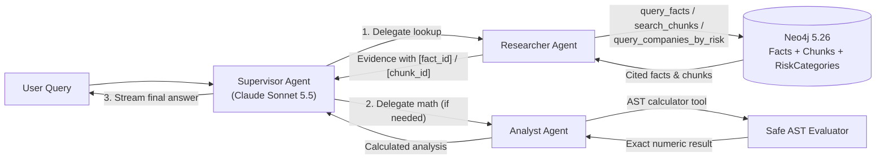

# SEC Filings Analyst — Multi-Agent GraphRAG

[](https://github.com/Van-nicks/SEC-Filings-Analyst/actions/workflows/ci.yml)

A GraphRAG and multi-agent financial analysis pipeline built over SEC Form 10-K filings for Apple (`AAPL`), Microsoft (`MSFT`), NVIDIA (`NVDA`), Amazon (`AMZN`), and Tesla (`TSLA`).

The system stores structured XBRL financial facts, vector-indexed 10-K text chunks, and risk classifications in a Neo4j knowledge graph, and queries them through a LangGraph supervisor orchestrating research and financial analysis agents on Amazon Bedrock.

---

## Tech Stack

| Layer | Technology | Purpose |
|---|---|---|
| Language | Python 3.14 | Core implementation |
| LLM (Agents & Judge) | Amazon Bedrock — Claude Sonnet 5.5 (`eu.anthropic.claude-sonnet-5-5` in `eu-west-2`) | Multi-agent reasoning, risk labeling, and Ragas evaluation |
| Embeddings | Amazon Bedrock — Titan Text Embeddings v2 (`amazon.titan-embed-text-v2:0`) | 1024-dim semantic chunk and query embeddings |
| Agent Orchestration | LangGraph & `langgraph-supervisor` | Multi-agent `supervisor` -> `researcher` -> `analyst` workflow and session memory |
| LLM Framework | LangChain (`langchain`, `langchain-aws`, `langchain-neo4j`) | Tool binding, Bedrock Converse streaming, and vector store integration |
| Graph & Vector DB | Neo4j 5.26 (Docker / Docker Compose) | Knowledge graph (`Company`, `Filing`, `Fact`, `Chunk`, `RiskCategory`) + HNSW vector index |
| SEC Data Ingestion | `edgartools`, BeautifulSoup4, `pandas` | SEC EDGAR Form 10-K text and XBRL financial fact extraction |
| Evaluation & CI/CD | `ragas==0.4.3`, Hugging Face `datasets`, `pytest`, GitHub Actions | 3-variant ablation, Ragas benchmarking, and automated CI testing |

---

## Architecture Overview



1. **SEC EDGAR Ingestion (`filing_analyst.ingest`)**
   - Downloads the latest Form 10-K filings (`Item 1 Business`, `Item 1A Risk Factors`, and structured XBRL financial facts: `revenue`, `net_income`, `total_assets` across two fiscal years per filing).
   - Splits filing sections into 819 deterministic chunks (`chunks.jsonl` — 234 `business` chunks and 585 `risk_factors` chunks) with exact character offsets and stable IDs (`<ticker>-<accession>-<section>-<NNN>`).

2. **Neo4j Knowledge Graph & Vector Index (`filing_analyst.graph`)**
   - Nodes: `Company` (5), `Filing` (5), `Fact` (30), `Chunk` (819), `RiskCategory` (10).
   - Relationships:
     - `(:Company)-[:FILED]->(:Filing)`
     - `(:Filing)-[:REPORTS]->(:Fact)`
     - `(:Filing)-[:HAS_CHUNK]->(:Chunk)`
     - `(:Chunk)-[:MENTIONS_RISK]->(:RiskCategory)` (971 edges)
   - Hybrid Retrieval: Combines Titan v2 semantic vector search (`chunk_embeddings`) with structured Cypher graph traversal (`search_chunks`, `query_facts`, `query_companies_by_risk`).

3. **Multi-Agent System (`filing_analyst.agent`)**
   - `supervisor`: Routes user queries, enforces brevity, and streams the final answer.
   - `researcher`: Queries the Neo4j knowledge graph first (`GRAPH-FIRST RULE`) and tags any out-of-graph fallback knowledge with `[SOURCE: MODEL_KNOWLEDGE - not present in Neo4j graph]`.
   - `analyst`: Performs financial arithmetic (YoY growth, net profit margins, multi-company aggregations) via an AST-validated `calculator` tool, operating strictly on the cited evidence returned by `researcher` without direct database tool access.
   - Interactive CLI: Streams clean answers by default and provides a `/verbose` toggle to inspect the full multi-agent trace, tool calls, and `[chunk_id]` / `[fact_id]` citations.

---

## Sample Q&A

**Example 1 — Financial Calculation (`Q11` from benchmark)**
```text
Ask a question: What was Apple's year-over-year revenue growth percentage from fiscal year 2024 to 2025?
  -> Researching in Neo4j graph...
  -> Analyzing & running calculations...

Answer:
Apple's revenue grew about 6.43% from fiscal 2024 to fiscal 2025. It rose from $391.035 billion to $416.161 billion.
```
*(In `/verbose` mode, `researcher` cites `[AAPL-revenue-2024]` and `[AAPL-revenue-2025]` from filing `0000320193-25-000079`, and `analyst` calls `calculator('(416161000000 - 391035000000) / 391035000000 * 100') -> 6.42551`.)*

**Example 2 — Qualitative Risk Lookup (`Q21` from benchmark, with citations)**
```text
Ask a question: What specific AI risks does Microsoft identify regarding autonomous or agentic AI systems?
  -> Researching in Neo4j graph...

Answer:
Microsoft's FY2026 10-K names only one risk specific to agentic AI. It says "human review of certain inputs and outputs or other forms of human oversight may be required, including for agentic AI systems that can take actions autonomously" [MSFT-0001193125-26-323660-risk_factors-057].

It treats agentic AI under its general AI risks:
- Flawed models and harmful output: Models and training methods may be flawed, datasets may be biased or inaccurate, and AI-generated content may be "offensive, illegal, inaccurate, or otherwise harmful" [MSFT-0001193125-26-323660-risk_factors-056].
- Poor deployment: Inadequate practices could harm individuals, customers, or society, or make products not work as intended [MSFT-0001193125-26-323660-risk_factors-057].
- Legal and reputational exposure: The filing lists legal liability, regulatory action, litigation, and reputational or competitive harm, tied to IP, data privacy, and product liability [MSFT-0001193125-26-323660-risk_factors-057].
- Over-reliance: Companion or highly personalized AI may cause harmful user dependence [MSFT-0001193125-26-323660-risk_factors-057].
```

---

## Project Structure

```text
filings_analyst/
├── .github/workflows/
│   └── ci.yml                      # GitHub Actions CI (syntax check + unit/artifact tests)
├── data/
│   ├── raw/                        # Raw 10-K sections (*_business.txt, *_risk_factors.txt, *_meta.json)
│   └── processed/                  # facts.csv, risk_labels.jsonl (committed); chunks.jsonl (regenerable)
├── eval/
│   ├── eval_dataset.json           # 30-question benchmark reference set
│   ├── eval_ragas.py               # Ragas evaluation script (faithfulness, relevancy, precision, recall)
│   ├── eval_results.json           # Saved per-question Ragas evaluation outputs
│   ├── eval_ablation.py            # 3-variant ablation & latency benchmark script (25 base + 5 multi-hop)
│   └── ablation_results.json       # Saved 3-variant accuracy, latency, and token/cost measurements
├── src/filing_analyst/
│   ├── config.py                   # Central configuration, paths, model IDs, and risk taxonomy
│   ├── ingest/
│   │   ├── sec_fetch.py            # SEC EDGAR 10-K text & XBRL fact downloader
│   │   └── chunk.py                # Deterministic 10-K text chunker
│   ├── graph/
│   │   ├── build_index.py          # Idempotent Neo4j vector index builder (Titan v2 embeddings)
│   │   ├── load_facts.py           # Knowledge graph loader & batch LLM risk classifier
│   │   └── retriever.py            # Hybrid vector + Cypher graph retrieval tools
│   ├── llm/
│   │   └── models.py               # Cached Amazon Bedrock chat & embedding clients
│   └── agent/
│       └── agents.py               # LangGraph supervisor, researcher, analyst & interactive CLI
├── tests/
│   ├── test_chunk.py               # Unit tests for 10-K chunking invariants
│   ├── test_calculator.py          # Unit tests for AST-validated calculator tool
│   └── test_data_artifacts.py      # CI verification for committed facts, risk labels & benchmark schema
├── docker-compose.yml              # Neo4j 5.26 service definition with healthcheck and volume
├── pyproject.toml
├── requirements.txt
└── requirements.lock.txt
```

---

## Setup & Installation

### 1. Start Neo4j (Docker Compose or Docker CLI)

Start the Neo4j 5.26 service using Docker Compose (reads `NEO4J_USERNAME` and `NEO4J_PASSWORD` from `.env`):

```bash
docker compose up -d
```

Or directly via `docker run`:

```bash
docker run -d \
  --name local-neo4j \
  -p 7474:7474 -p 7687:7687 \
  -e NEO4J_AUTH=neo4j/your_password_here \
  -v neo4j_data:/data \
  neo4j:5.26.0
```

### 2. Create Virtual Environment & Install Dependencies

```bash
python3 -m venv .venv
source .venv/bin/activate
pip install -r requirements.txt
pip install -e .
```

### 3. Configure Environment Variables & AWS Bedrock Access

Copy `.env.example` to `.env` and fill in your values:

```bash
cp .env.example .env
```

Required variables in `.env`:
- `AWS_BEARER_TOKEN_BEDROCK` (or standard AWS IAM credentials in `~/.aws/credentials`)
- `AWS_DEFAULT_REGION` (tested in `eu-west-2`)
- `BEDROCK_CHAT_MODEL_ID` (optional; defaults to `eu.anthropic.claude-sonnet-5-5`, the EU cross-region inference profile. In US regions, set `us.anthropic.claude-sonnet-5-5`)
- `EDGAR_IDENTITY` (format: `"Your Name your.email@example.com"`)
- `NEO4J_URI` (`bolt://localhost:7687`)
- `NEO4J_USERNAME` (`neo4j`)
- `NEO4J_PASSWORD` (matching `NEO4J_AUTH` above)

**AWS Bedrock Requirements:** Your IAM principal needs `bedrock:InvokeModel` and `bedrock:InvokeModelWithResponseStream` permissions with model access enabled for `amazon.titan-embed-text-v2:0` and the `anthropic.claude-sonnet-5-5` cross-region inference profile.

---

## End-to-End Pipeline Usage

### Step 1: Fetch SEC 10-K Filings
Downloads the latest 10-K `business` and `risk_factors` sections to `data/raw/` and structured XBRL metrics to `data/processed/facts.csv`:

```bash
python -m filing_analyst.ingest.sec_fetch
```

### Step 2: Build the Vector Index (Run Once)
Chunks the 10-K text (`data/processed/chunks.jsonl`), embeds all 819 chunks with Bedrock Titan v2, and creates the `chunk_embeddings` vector index in Neo4j. Automatically skips if all 819 chunks are already indexed (pass `--force` to rebuild):

```bash
python -m filing_analyst.graph.build_index
```

### Step 3: Populate the Knowledge Graph & Risk Categories (Run Once)
Loads `Company`, `Filing`, `Fact`, and `RiskCategory` nodes into Neo4j and links `:FILED`, `:REPORTS`, `:HAS_CHUNK`, and `:MENTIONS_RISK` edges:

```bash
python -m filing_analyst.graph.load_facts
```

**How Risk Categories Are Assigned:**
- `config.py` defines 10 fixed risk categories (`supply_chain`, `export_controls_and_geopolitics`, `cybersecurity_and_data`, `regulation_and_legal`, `competition_and_demand`, `macroeconomic_and_financial`, `intellectual_property`, `workforce_and_governance`, `product_quality_and_liability`, `climate_and_disasters`).
- `load_facts.py` classifies the 585 `risk_factors` chunks in batches of 15 using Claude on Bedrock (`temperature=0.0`), assigning category names from the allowlist (576 chunks assigned categories producing 971 `:MENTIONS_RISK` edges; 9 boilerplate/header chunks assigned `[]`).
- To make fresh clones reproducible without extra Bedrock calls, the resulting `data/processed/risk_labels.jsonl` file is committed to Git via `!.gitignore` exception. Pass `--force-relabel` to regenerate `risk_labels.jsonl` from scratch.

### Step 4: Run the Interactive Multi-Agent CLI
Start the interactive assistant:

```bash
python -m filing_analyst.agent.agents
```

- Default Mode (`verbose=OFF`): Displays status updates while sub-agents query Neo4j and streams the final answer.
- Trace Mode (`/verbose`): Type `/verbose` at the prompt to toggle the full multi-agent trace, tool invocations, and `[chunk_id]` / `[fact_id]` citations.
- Quit: Type `q` or `exit`.

---

## Testing & Evaluation

### 1. Automated Unit Tests & CI (`pytest`)
Covers three test suites (13 tests total):
- `tests/test_chunk.py` (6 tests): Verifies global `chunk_id` uniqueness, contiguous `0..N-1` numbering per file, presence of both sections for all 5 tickers, minimum chunk length (`>= 150` chars), exact character-offset alignment (`raw_text[start : start + len] == chunk`), and deterministic re-runs.
- `tests/test_calculator.py` (4 tests): Verifies arithmetic and parentheses evaluation, currency/thousands-comma stripping (`$`, `,`), allowed functions (`round`, `abs`, `min`, `max`), and rejection of unsafe AST nodes (`__import__`, `open`, attribute access, lambdas).
- `tests/test_data_artifacts.py` (3 tests): Validates schema and completeness of committed `facts.csv` (30 facts), `risk_labels.jsonl` (585 chunks, 971 edges), and `eval_dataset.json` (30 questions) in GitHub Actions CI.

```bash
pytest -v
```

### 2. 3-Variant Ablation, Accuracy & Latency Study (`eval/eval_ablation.py`)
To compare the multi-agent GraphRAG design against simpler baselines, `eval/eval_ablation.py` evaluates three architectures across 30 in-scope questions (`Q01`–`Q25` from `eval/eval_dataset.json` plus 5 multi-hop questions `MH01`–`MH05` that combine risk categories, XBRL facts, and arithmetic in a single query):

- Variant A — Vector-Only RAG (`vector_only`): Single agent with `search_chunks` only (no structured `Fact` or `RiskCategory` lookup tools, no `calculator`).
- Variant B — Single-Agent GraphRAG (`single_agent`): Single agent given all 4 tools (`search_chunks`, `query_facts`, `query_companies_by_risk`, `calculator`).
- Variant C — Multi-Agent GraphRAG (`multi_agent`): `supervisor` -> `researcher` -> `analyst` workflow.

```bash
python eval/eval_ablation.py
```

#### Ablation Results (`eval/ablation_results.json`, recorded 2026-10-26)

| Metric | Variant A: Vector-Only RAG | Variant B: Single-Agent GraphRAG | Variant C: Multi-Agent GraphRAG |
|---|---|---|---|
| Overall Source Hit Rate (n=30) | 23.3% (7 / 30) | **100.0% (30 / 30)** | **100.0% (30 / 30)** |
| Numeric Accuracy — 1 decimal (n=23) | 0.0% (0 / 23) | **100.0% (23 / 23)** | **100.0% (23 / 23)** |
| Numeric Accuracy — 2+ decimals (n=23) | 0.0% (0 / 23) | 69.6% (16 / 23) | **82.6% (19 / 23)** |
| — Fact Lookups (n=10, 2+ dec) | 0.0% (0 / 10) | 100.0% (10 / 10) | 100.0% (10 / 10) |
| — Calculations & Comparisons (n=8, 2+ dec) | 0.0% (0 / 8) | 50.0% (4 / 8) | 75.0% (6 / 8) |
| — Multi-Hop Queries (n=5, 2+ dec) | 0.0% (0 / 5) | 40.0% (2 / 5) | 60.0% (3 / 5) |
| — Qualitative Risk Retrieval (n=7 hit rate) | 100.0% (7 / 7) | 100.0% (7 / 7) | 100.0% (7 / 7) |
| Measured Latency — Median / p95 (n=30) / Max | 6.71s / 12.19s / 13.72s | **4.76s / 8.70s / 16.69s** | 9.52s / 17.33s / 23.76s |
| Avg Tokens per Query (Input + Output) | 10,779 in + 570 out | **5,724 in + 417 out** | 10,902 in + 875 out |
| Estimated LLM Cost per Query* | $0.0409 | **$0.0234** | $0.0458 |

*\*Cost Assumption: Calculated using reference Claude Sonnet pricing of $3.00 per 1M input tokens and $15.00 per 1M output tokens (as of October 2026; verify against current AWS Bedrock EU cross-region inference profile rates). Excludes Titan v2 query embedding costs (~$0.00002/query) and local Neo4j container hosting.*

**Observations from the Ablation:**
1. **Structured fact retrieval is required for numeric questions:** Variant A achieves 100% retrieval on the qualitative risk questions (`Q19`–`Q25`), where all three variants perform identically on this benchmark, but scores 0% on numeric lookups, calculations, and multi-hop queries because XBRL figures live in `Item 8` financial tables rather than `Item 1`/`1A` narrative chunks. Additionally, Variant A's median latency (6.71s, 10,779 input tokens) is slower than Variant B (4.76s, 5,724 input tokens) because without `query_facts`, Variant A issues repeated vector chunk searches trying to locate missing financial numbers in narrative text.
2. **Single-Agent vs. Multi-Agent trade-off at small vs. large scale:** On this 5-company dataset, **Variant B (Single-Agent with all 4 tools) is the most practical choice on cost and latency**, matching Variant C on source retrieval (30/30) and 1-decimal numeric accuracy (23/23) at roughly half the latency (4.76s vs. 9.52s) and half the token cost ($0.0234 vs. $0.0458). In this single run (n=23), Variant C scored 19/23 (82.6%) vs. Variant B's 16/23 (69.6%) at 2+ decimal places—a 3-question difference that can reflect single-run LLM variance or prompt rounding differences. However, the multi-agent split (`researcher` for retrieval, `analyst` isolated to `calculator` over retrieved evidence) is designed for **context isolation and auditability as corpus size scales** (e.g., expanding to 500+ tickers, 10+ metrics, and multi-year 10-K/10-Q filings), where keeping raw multi-page chunk payloads out of the calculation and synthesis context prevents context-window bloat and tool-selection confusion.

---

### 3. Ragas Evaluation (`eval/eval_ragas.py` & `eval/eval_dataset.json`)
`eval/eval_dataset.json` contains 30 benchmark question–answer pairs (`Q01`–`Q10` lookups, `Q11`–`Q18` calculations/comparisons, `Q19`–`Q25` qualitative risks, and `Q26`–`Q30` out-of-graph refusal/brevity tests).

```bash
python eval/eval_ragas.py
```

#### Ragas Scores (`eval/eval_results.json`, `ragas==0.4.3`, recorded 2026-10-26)
Evaluated on the multi-agent workflow (prior to the multi-argument `round` patch in `calculator`, which did not affect any expressions generated during the run) using `eu.anthropic.claude-sonnet-5-5` as judge LLM and `amazon.titan-embed-text-v2:0` as embeddings:

| Metric | In-Scope 10-K Questions (`Q01`–`Q25`) | All 30 Questions (incl. Out-of-Graph Boundary Tests `Q26`–`Q30`) |
|---|---|---|
| **Ragas Faithfulness** *(LLM judge)* | **0.9723** *(n=24; Q20 hit Ragas JSON parser token limit)* | 0.9020 *(n=29)* |
| **Ragas Context Recall** *(LLM judge)* | **0.9600** *(n=25)* | 0.9556 *(n=30)* |
| **Ragas Answer Relevancy** *(LLM judge)* | **0.9126** *(n=25)* | 0.8133 *(n=30; refusals on Q26/Q28/Q29 score 0.0 by design)* |
| **Ragas Context Precision** *(LLM judge)* | **0.8933** *(n=25)* | 0.8944 *(n=30)* |

---

## Limitations & Caveats

- **Single-Run Variance & Small Sample Size:** The ablation and Ragas metrics were recorded from single evaluation runs over 30 questions (`n=23` numeric, `n=7` qualitative). Small differences (such as 19/23 vs. 16/23 at 2+ decimal places between Variant C and Variant B, or p95 latency over 30 queries) are within single-run LLM variance and prompt-formatting sensitivity.
- **Structured Table vs. Graph Ablation:** Variant A tests narrative vector search (`search_chunks`) against graph-backed tools (`Variant B` and `Variant C`). We did not test a separate variant backed by a flat SQL/CSV lookup table without Neo4j; on single-hop fact lookups (`Q01`–`Q18`) and qualitative queries (`Q19`–`Q25`, where all three variants scored 7/7), a relational table + vector store would perform similarly, whereas graph traversal (`query_companies_by_risk`) specifically targets multi-hop risk-to-company queries (`MH01`).
- **Self-Evaluation Judge Bias:** Both the agent pipeline and the Ragas evaluator use `eu.anthropic.claude-sonnet-5-5`. Using the same model family as generator and judge can bias LLM-judged faithfulness and relevancy scores upward; rely on the deterministic retrieval hit rate and numeric accuracy alongside Ragas scores.
- **Dataset Scope & Filing Snapshot:** The graph covers 5 companies (`AAPL`, `MSFT`, `NVDA`, `AMZN`, `TSLA`), one 10-K filing per company (filings dated between October 2025 and July 2026 covering FY2024–FY2026), and 3 structured metrics (`revenue`, `net_income`, `total_assets` — 30 facts total). Results on this benchmark do not generalize to arbitrary SEC filings or complex multi-table footnotes.
- **Unvalidated Risk Taxonomy Labels:** The 971 `(:Chunk)-[:MENTIONS_RISK]->(:RiskCategory)` edges in `risk_labels.jsonl` were assigned by LLM batch classification without human annotation review.
- **`langgraph-supervisor` Package Status:** Orchestration uses `langgraph-supervisor` (`0.0.31`). LangChain now recommends the subagents-as-tools pattern with `create_agent` for new projects, though `langgraph-supervisor` remains functional here.
- **Not Investment Advice:** This repository is an engineering demonstration over historical SEC filings and does not constitute financial or investment advice.

---

## Naming Conventions

- GitHub Repository: `SEC-Filings-Analyst`
- Project Directory: `filings_analyst`
- Python Package (import name): `filing_analyst` (`src/filing_analyst`)
- Distribution Name (`pyproject.toml`): `filings-analyst`
